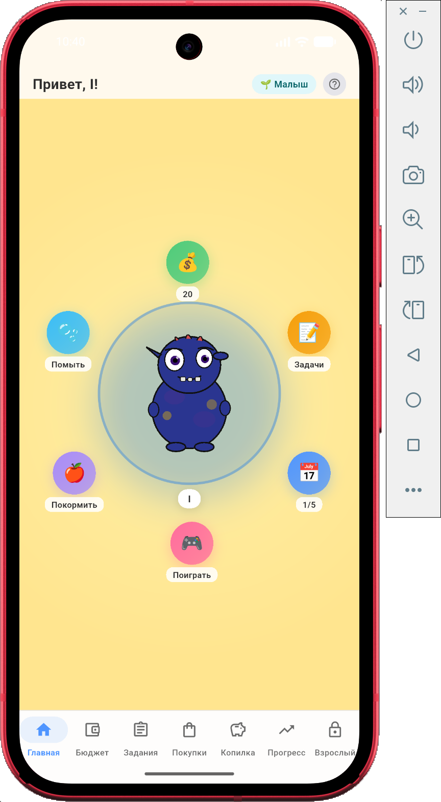
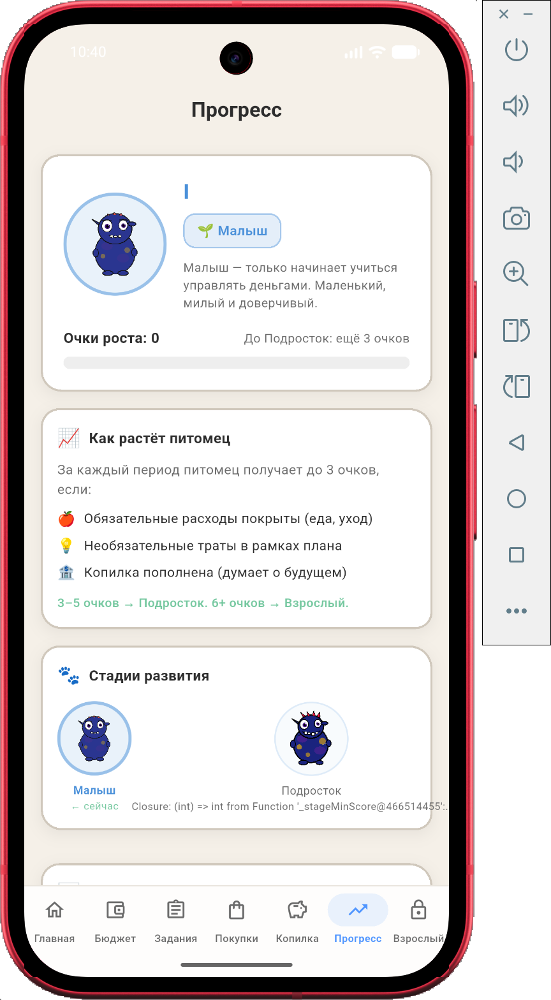
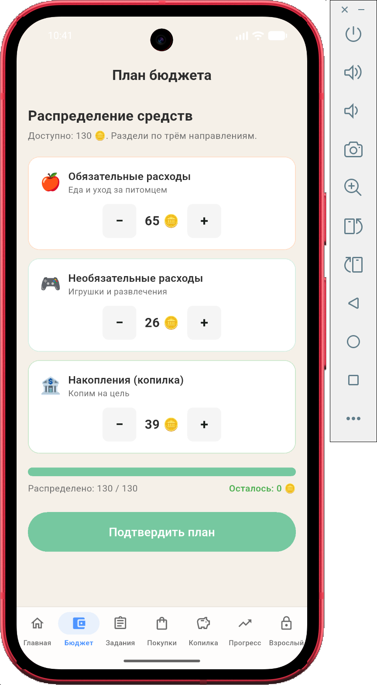

# finny_pet

Прототип риложения для уроков по математике.
За основу взято приложение из хакатона https://i.moscow/hackaton/lct/1b46fdf5991144eea75d3c29769257a1
Мобильное приложение по повышению финансовой грамотности детей и молодежи Москвы.
Приложение разработано в Qwen code cli+ Qwen3.8-27B-Q4_0. Все запушено на сервере llama.cpp на локальном ноутбуке.

Есть некоторые баги, при наличии времени буду исправлять.
